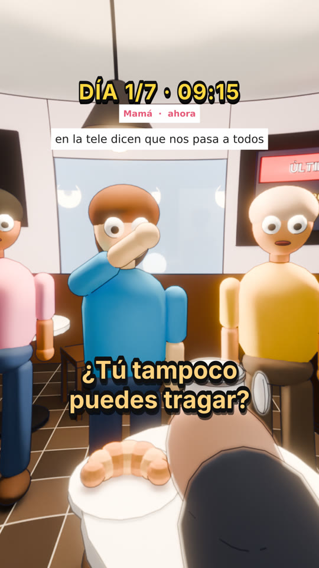

# Referencias: cómo tiene que verse una escena

Los vídeos que funcionan (los de referencia que nos pasó el dueño) **cuentan una historia que pasa delante de
ti**. No narran datos sobre escenas sueltas. Esta es la escena modelo que el sistema tiene que saber hacer.

**Tema:** «¿Qué pasaría si tu cuerpo dejara de producir saliva?». Es un tema de dentro del cuerpo: ya no se
eligen, pero sirve de ejemplo de cómo contar algo en pantalla.

## Qué hace que funcione

| Qué se ve | Cómo se hace en el sistema |
|---|---|
| Estás sentado en una cafetería, en primera persona, con el café en la mano | receta `reaction`, `room: cafe`, `item: cup` |
| Lucía, tu amiga, se lleva la mano a la garganta: **no puede tragar** | `companion` del guion + `gesture: throat` |
| Lo dice ella, con su voz, en amarillo: «¿Tú tampoco puedes tragar?» | `scene.speaker = "Lucía"` (voz Kokoro propia) |
| El cruasán sigue en el plato, sin tocar | `object: croissant` (objeto hecho a mano, en la mesa) |
| Tu madre te escribe: «en la tele dicen que nos pasa a todos» | `scene.phone` (notificación en pantalla) |
| Contador «DÍA 1/7 · 09:15», estilo ilustrado con contorno, lente ojo de pez | `hud`, `look: toon`, `FISHEYE` |

## Reglas

1. **Tiene que pasar en directo.** Si una frase dice que alguien no puede tragar, se ve el gesto y el objeto.
   Nunca una escena donde solo se habla de ello.
2. **Una persona con nombre vive la historia contigo**, habla con su voz y aparece cuando habla.
3. **El objeto de la frase está en la escena** (en la mesa, en la pared para tu mano, en la calle).
4. **Nada de carteles flotando:** ni números en 3D ni textos en las fachadas.
5. **Termina con una elección:** «¿QUÉ HARÍAS? A / B — comenta para la parte 2».

Gestos disponibles: `throat` (garganta), `cover` (se protege la cabeza), `point` (señala), `wave` (saluda),
`reach` (tiende la mano), `jump` (salta), `fall` (cae).

Objetos de mesa hechos a mano: cruasán, vaso, botella, carta y pastillas. Para la pared: alarma, botón, grifo
y palanca. Animales: T-rex y saurópodo. Cualquier otra cosa concreta la diseña Gemini con formas simples.
